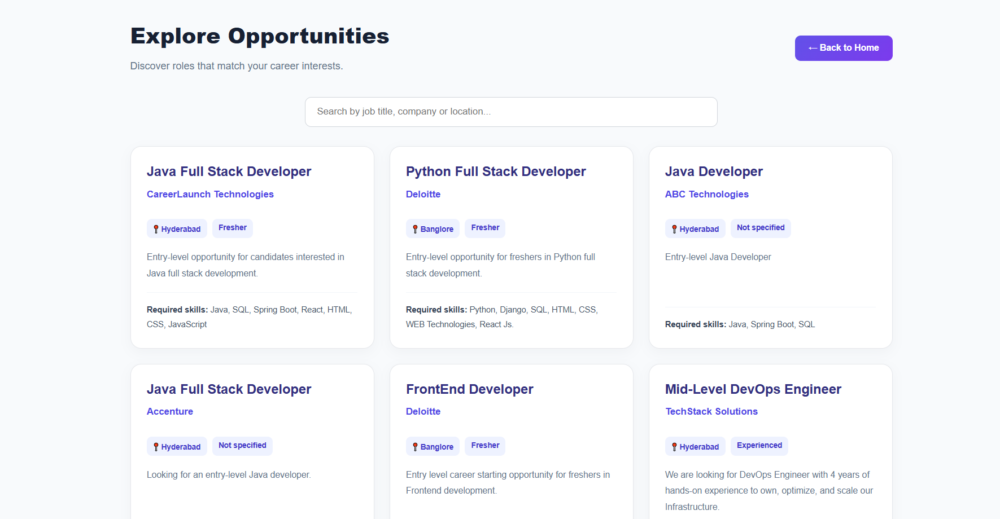
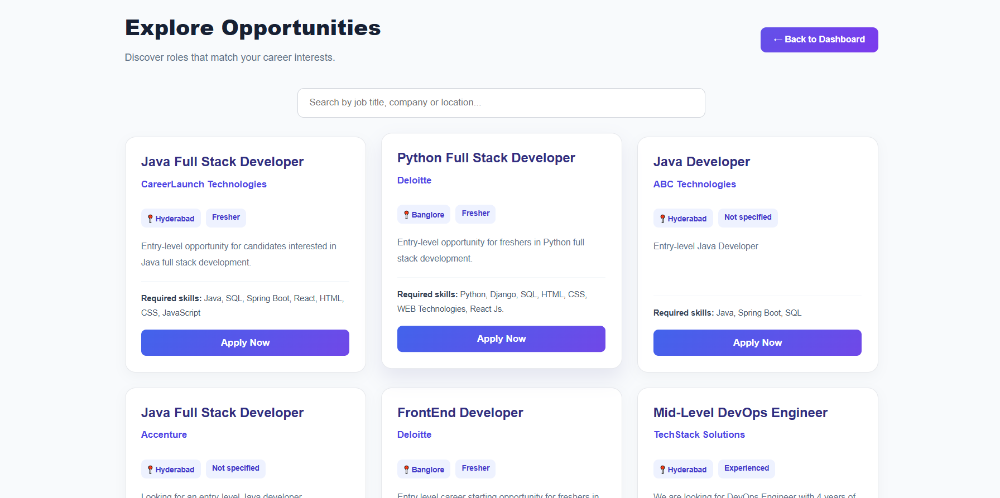
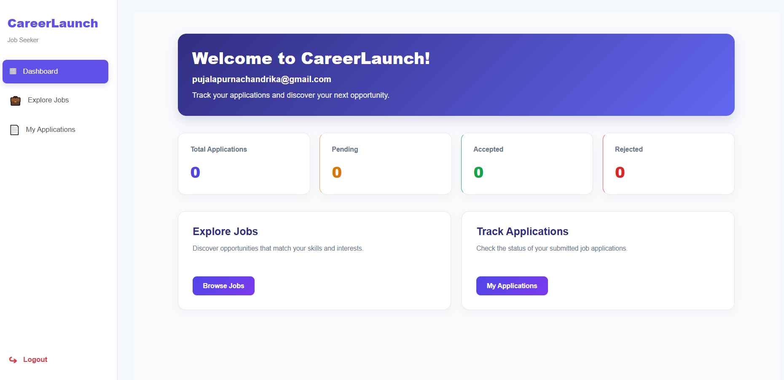
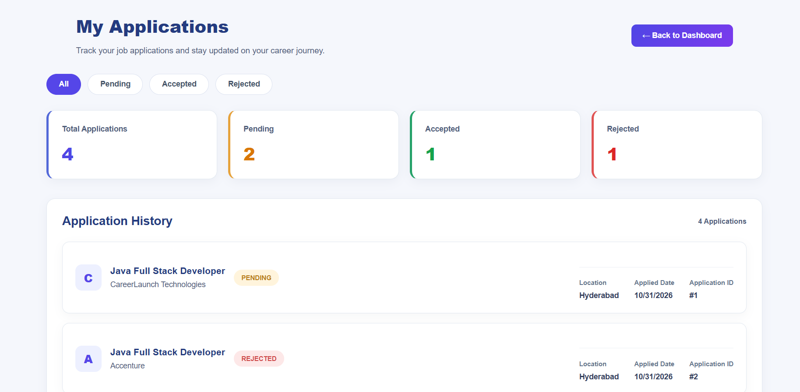
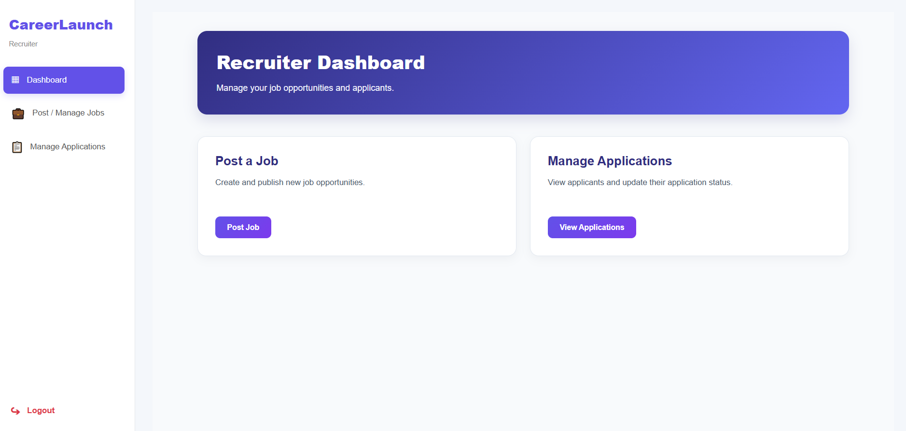
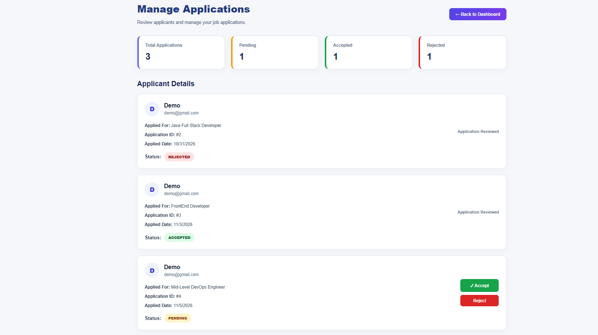

# CareerLaunch – Full Stack Job Portal

CareerLaunch is a full-stack job portal application that connects job seekers with recruiters. Job seekers can explore opportunities and track their applications, while recruiters can post jobs and manage applicants.

## Features

### Job Seeker
- User registration and login
- Browse available job opportunities
- Search jobs by title, company, and location
- View job details and required skills
- Apply for jobs
- Track application status
- View application statistics

### Recruiter
- Recruiter registration and login
- Post new job opportunities
- Manage posted jobs
- View applicants for job postings
- Accept or reject applications
- Track application statuses

## Screenshots

### Home Page


### Explore Jobs – Guest View


### Job Seeker Job Listing


### Job Seeker Dashboard


### My Applications


### Recruiter Dashboard


### Manage Applications


## Technologies Used

**Frontend:** React.js, JavaScript, HTML5, CSS3, Axios, React Router

**Backend:** Java 17, Spring Boot, Spring Security, Spring Data JPA, Hibernate, JWT, Maven

**Database:** MySQL

**Tools:** Eclipse IDE, Visual Studio Code, Postman, Git, GitHub

## Project Structure

```text
CareerLaunch/
├── careerlaunch-backend/
│   ├── src/
│   ├── pom.xml
│   └── mvnw
│
├── careerlaunch-frontend/
│   ├── public/
│   ├── src/
│   ├── package.json
│   └── vite.config.js
│
├── screenshots/
│   ├── home.png
│   ├── explore-jobs.png
│   ├── job-details.png
│   ├── job-seeker-dashboard.png
│   ├── my-applications.png
│   ├── recruiter-dashboard.png
│   └── manage-applications.png
│
├── .gitignore
└── README.md
```

## Getting Started

### Prerequisites
- Java 17
- Node.js and npm
- MySQL
- Git

### 1. Clone the Repository

```bash
git clone https://github.com/PujalaPurnaChandrika/CareerLaunch.git
cd CareerLaunch
```

### 2. Configure the Database

Create a MySQL database for the application.

Configure these environment variables for the backend:

```properties
DB_URL=jdbc:mysql://localhost:3306/your_database_name
DB_USERNAME=your_mysql_username
DB_PASSWORD=your_mysql_password
JWT_SECRET=your_base64_encoded_secret
```

Use your own database credentials and a secure Base64-encoded JWT secret. Never commit real credentials.

### 3. Run the Backend

Open the `careerlaunch-backend` folder in Eclipse and configure the environment variables in the run configuration.

Run `CareerlaunchBackendApplication.java` as a Spring Boot application.

Backend URL: `http://localhost:8080`

### 4. Run the Frontend

Open a terminal inside `careerlaunch-frontend` and execute:

```bash
npm install
npm run dev
```

Frontend URL: `http://localhost:5173` (or the port displayed by Vite).

## Authentication and Security

- JWT-based authentication
- Password hashing using BCrypt
- Role-based access control
- Protected recruiter and job seeker endpoints
- Recruiter ownership verification for job management

## Application Roles

| Role | Responsibilities |
|---|---|
| Job Seeker | Browse jobs and apply for opportunities |
| Recruiter | Post jobs and manage applications |

## Author

**Pujala Purna Chandrika**

GitHub: [PujalaPurnaChandrika](https://github.com/PujalaPurnaChandrika)

---

*CareerLaunch – Connecting Talent with Opportunities.*
